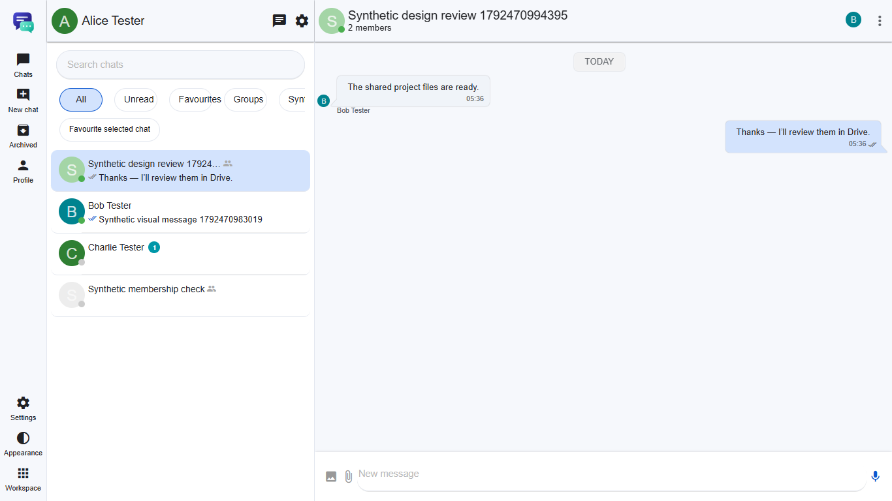
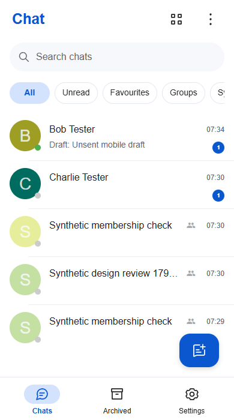

<h1>Chat</h1>

Your conversations, together.

<a href="https://github.com/oneworkspacestudio/chat/releases">Download for Windows</a> · <a href="docs/workspace/HOSTING.md">Hosting guide</a>

Chat is the One Workspace messaging app, built from [Tinode](https://github.com/tinode/chat)
and its [web client](https://github.com/tinode/webapp). It brings direct messages,
group conversations, message history and file attachments into your workspace.

The current upgrade is an **incomplete development candidate** for the WhatsApp
parity brief. It adds tested messaging reliability, isolated hosting, offline
reconnect, custom lists and Workspace navigation. See the
[implementation status](docs/whatsapp-parity/IMPLEMENTATION-STATUS.md) and
[platform feature matrix](docs/whatsapp-parity/features.csv) for the remaining work.

Browser capture with synthetic users. [Narrow layout and evidence](docs/whatsapp-parity/evidence/README.md).

## One account, connected conversations

Open Chat from One Workspace to reuse MyAccounts sign-in. There is no separate
Chat username or password. One Workspace connects MyAccounts members automatically,
so you can find them before their first Chat sign-in. Search by name, username,
verified email or account ID; the By ID tab accepts Chat IDs and QR links.
The client uses the One Workspace design system and a matching navy, mint and
silver icon. Browser libraries, translations and the icon font are served locally.
Lists and favourites synchronize between signed-in sessions. Drafts remain on
their account and conversation until the server confirms a send. Reconnecting
reuses a durable message ID so an acknowledgement retry does not send another copy.

Managed Chat 5–9 requires **One Workspace 43 or newer**. It gets its own browser
hostname, reuses the existing MyAccounts identity and keeps old Workspace Chat
links working. The app switcher links to installed apps without sharing portal
cookies, browser storage or scripts with Chat.

## Windows without Docker

Run Chat.exe. It manages Tinode and a private PostgreSQL runtime automatically.
With One Workspace, the installer supplies the protected data folder and registers
its own MyAccounts OIDC client. Standalone deployment uses the same executable
with a configured MyAccounts issuer and registered client; see the hosting guide.

Messages remain in PostgreSQL files under your chosen protected data folder.
Attachments remain ordinary files beside that database. No hosted Tinode account
or cloud database is required. One executable starts the app; it extracts bundled
runtime software on first use, so it is not a zero-file executable.

## Build locally

See [BUILD.md](docs/workspace/BUILD.md). Source includes the exact vendored web
client and modifications; dependency versions and database hashes are pinned.
GitHub Actions are disabled.

## Preview scope

Candidate version: 0.1.0-preview.9. See [acceptance scope](docs/workspace/ACCEPTANCE.md)
and the [security boundary](docs/whatsapp-parity/SECURITY.md). Release/download
acceptance remains separate from development fixture results. The actual public
Workspace45 downloads passed default-online fresh setup and rollback/paired
upgrade checks with8; see [public integration evidence](docs/whatsapp-parity/evidence/release-8-public45-integration.json).

Application messages and attachments are **not end-to-end encrypted**. The shared
OpenMLS native/browser module is a protocol proof, not production Chat encryption.
Device trust/recovery, complete social families, calls and native Android/iOS
clients remain incomplete. No full-parity, exact pixel-match or physical-device
acceptance is claimed.

## Mobile layout

Preview9 revises the phone header, navigation, chat list and composer and keeps
the Workspace picker's close action above its scrolling app grid.
[Reference and verification scope](docs/whatsapp-parity/MOBILE-LAYOUT.md).

<picture>
  <source media="(prefers-color-scheme: dark)" srcset="docs/whatsapp-parity/evidence/release-9-mobile-dark-390.png">
  
</picture>

[Packaged mobile verification](docs/whatsapp-parity/evidence/release-9-mobile.json).

## Licenses and upstream

Tinode server: GPL-3.0. Web client: Apache-2.0. PostgreSQL and bundled dependency
licenses remain included. [Notices](NOTICE) · [upstream README](UPSTREAM-README.md).
The upstream projects are credited; this fork is maintained by One Workspace Studio.
