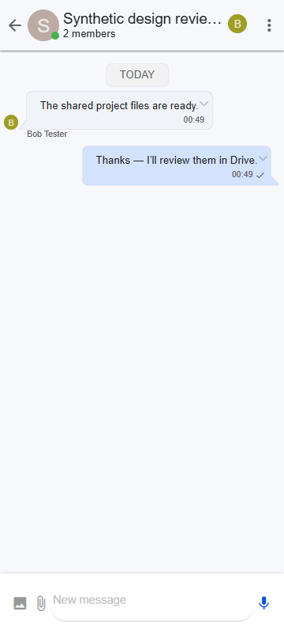
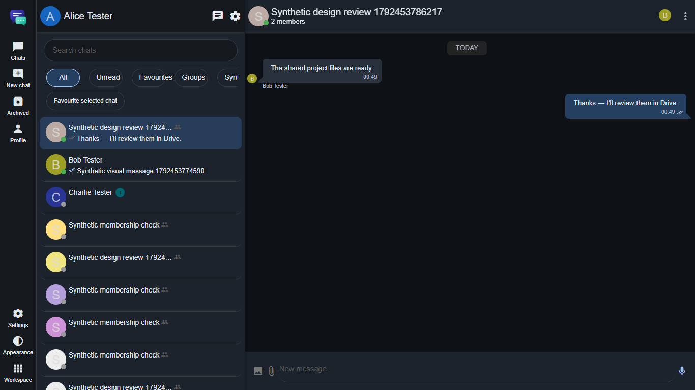
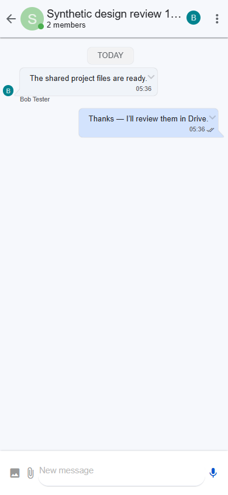
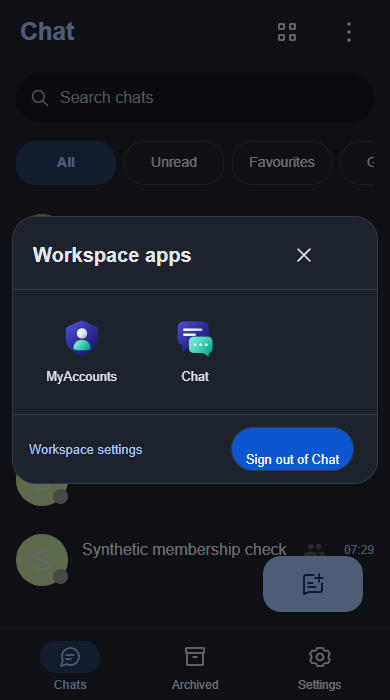

# Evidence

Only synthetic accounts and conversation content. No credentials, cookies,
tickets, client keys, packet bodies or owner conversations are included.

These are development fixture results, not final published-download, physical
mobile, production encryption or full-parity acceptance. `development-build.json`
identifies the exact development executable and its uncommitted source boundary.
The other JSON files contain asserted outcomes from real services. The crypto
proof is separate from the messenger's current plaintext transport/storage.

| Layout | Light | Dark |
|---|---|---|
| Desktop 1365×768 |  |  |
| Narrow 390×844 |  |  |

Additional captures cover430×932,768×1024 and1920×1080. This is desktop Chrome
viewport emulation on Windows, not an Android/iOS device result. A real native
group was created in the UI, Bob was added through the member form, and the two
users exchanged actual messages before capture. Computed bubble colours and
document overflow were asserted in both themes.

Authenticated, versioned WhatsApp reference captures are unavailable; no invented
side-by-side reference or pixel-match result is supplied.

## Release5 increment

`release-5-build.json` records the clean source and executable mapping.
`release-5-acceptance.json` records assertions against that exact executable,
including360×800 and1366×768 in addition to the original five sizes. The separate
`release-5-old-manager.json` records actual public42 automatic rollback when
offered the incompatible executable in an explicit compatibility-test bundle.
`release-5-public-contract.json` records public ZIP digest verification and the
old manager's refusal of the published independent update contract. This does
not claim the final public Workspace43 install/upgrade test has run.

Representative manually reviewed release captures:

## Release8 / actual public Workspace45

`release-8-public45-integration.json` records anonymous public file verification,
default-online fresh installation, supported rollback/reapply, preserved SSO,
identities/history/document bytes and installed-service/public-health checks.
Owner content/sign-in was not used as a test fixture; browser checks use synthetic
accounts. Physical phones, full parity and application E2EE remain incomplete.

The following capture is from the actual downloaded Workspace45 / Chat8 fresh
installation, after real group creation and messages, rather than a mockup.

## Release9 mobile correction

Actual packaged Chat9 /2eca735e mobile layout, real two-user delivery, locale-aware
conversation times, native chat menu, modal dismissal, draft preservation and ten
size/theme captures passed.
The20-entry catalog expansion is a DOM-only layout stress check; real destinations
and authorization use actual services. No physical-phone/full-parity claim.
[Exact scope and binary mapping](release-9-mobile.json).

