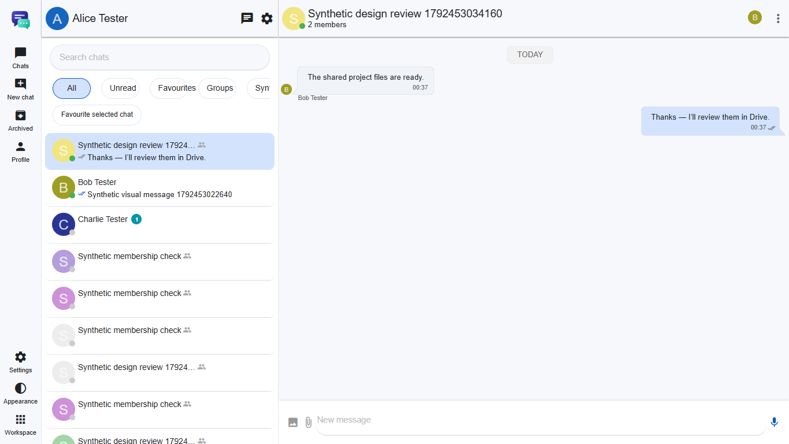
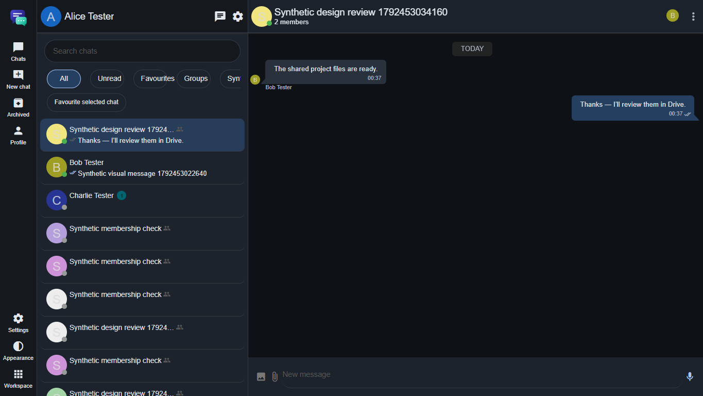
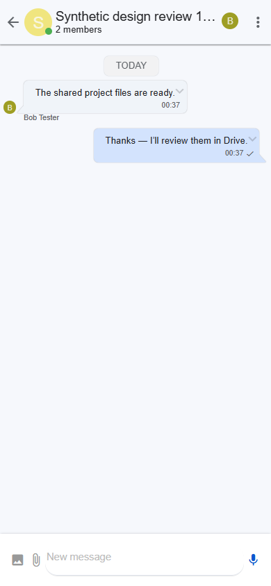
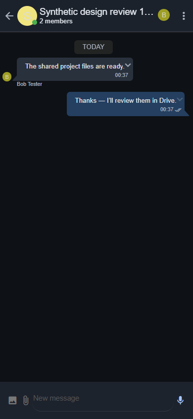

# Evidence

Only synthetic accounts and conversation content. No credentials, cookies,
tickets, client keys, packet bodies or owner conversations are included.

These are development fixture results, not final published-download, physical
mobile, production encryption or full-parity acceptance. `development-build.json`
identifies the exact development executable and its uncommitted source boundary.
The other JSON files contain asserted outcomes from real services. The crypto
proof is separate from the messenger's current plaintext transport/storage.

| Layout | Light | Dark |
|---|---|---|
| Desktop 1365×768 |  |  |
| Narrow 390×844 |  |  |

Additional captures cover430×932,768×1024 and1920×1080. This is desktop Chrome
viewport emulation on Windows, not an Android/iOS device result. A real native
group was created in the UI, Bob was added through the member form, and the two
users exchanged actual messages before capture. Computed bubble colours and
document overflow were asserted in both themes.

Authenticated, versioned WhatsApp reference captures are unavailable; no invented
side-by-side reference or pixel-match result is supplied.
